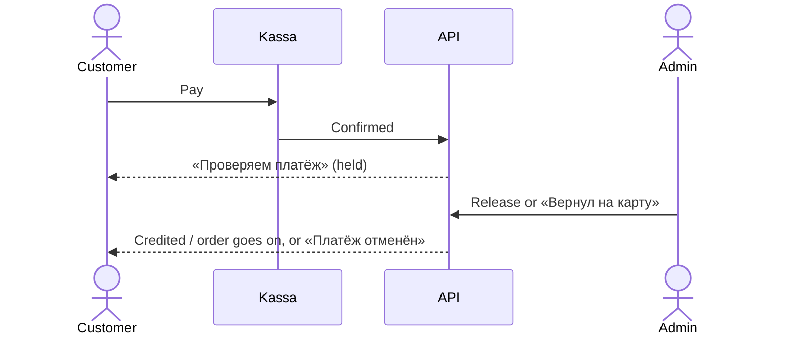

# Flow — A payment is checked

Some kassa payments wait for an admin before they count (design: ADR-0022; operations:
`docs/runbooks/payment-held-for-review.md`). The buyer is never told why.

## What the customer sees

1. They pay in Click, Payme, Uzum or by a card transfer as usual. The kassa shows success.
2. The top-up page or the order page says «Оплата получена, проверяем платёж.» No time promise,
   no reason. An order shows no trade countdown. The top-up page checks every 20 seconds; the
   order page follows the live updates.
3. Released: the balance grows («Баланс пополнен на …») or the order goes on to its skin trade.
4. Returned: «Платёж отменён, деньги возвращены на карту.» Nothing reaches the balance.
5. If the user's kassa payments are blocked, starting one answers «Оплата картой недоступна для
   вашего аккаунта. Напишите в поддержку.»; paying from the balance still works.

Full technical diagram: `docs/architecture/sequence-diagrams/payment-hold.mmd`.
